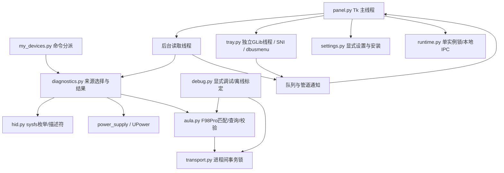

# 架构与间接影响审查

本文保留重构前审查基线；已处理身份口径、stale 归并和来源选择，并建立适配器、统一服务和版本化配置。最新结构见 [当前架构](architecture.md)，结果及剩余验证空白见 [重构进度](refactor-progress.md)。下文旧结构及风险描述不作为最新实现说明。

2026-10-29；按 safe-code-simplification 与 change-blast-radius 审查。
结论：当前框架适合**本机单台 F98Pro 的 Ubuntu 工具**；不宜宣称为通用、多设备、自动逆向平台。先收敛设备身份和结果契约，再考虑适配器注册，而不是先抽象原生 GUI 或重写事件循环。

## 基线与本次范围

目录有只读 `.git` 占位目录，但不是有效 Git 仓库，不能可靠计算历史 working diff。
本次修改前为 27 个现有源码、测试、打包和文档文件建立独立快照及 SHA256 清单，位置见 `review-baseline.json`。它只代表本次开始时的状态，不能推断更早的用户修改归属。
本次只做局部整理、标定输入错误处理和文档，不启用设备插件、不执行设备命令、不重启现有实例、不安装依赖、不更改用户自启/桌面/udev 设置。
`review-changes.patch` 是本次代码和测试改动的独立补丁；没有初始化仓库或提交。

## 当前结构与数据流

| 层 | 当前位置 | 合理之处 | 边界 |
|---|---|---|---|
| 入口 | `my_devices.main` | 无 GUI 的诊断/单次读取，GUI 延迟导入 | 参数分派已较多，尚无通用设备选择 UI |
| 设备与描述符 | `hid.enumerate_hid/parse_descriptor` | 枚举不打开 HID，能处理位偏移/编号报告，异常描述符不当作已支持 | 标准电量字段只发现、未完整接入通用读取 |
| 来源编排 | `diagnostics.snapshot/battery_result/read_battery` | 先系统来源，再已验证协议；有明确状态、来源和时间 | F98Pro 分支硬编码，USB 物理归组不能直接推广至所有总线 |
| 协议 | `aula.select_interface/_query/parse_reply` | 严格描述符、唯一候选、打开后再验身份、校验回复 | 协议编码与 hidraw 交换在同一模块，对单设备尚可 |
| 事务 | `transport.transaction` | 保持相同全局 flock，自动读取/调试互斥 | 全局串行，多设备吞吐受限；暂不改成每设备锁 |
| GUI | `Panel` / `DebugPanel` | Tk 只在主线程，管道唤醒，读取合并 | 标题、默认设备及结果取舍仍与单设备绑定 |
| 桌面原生层 | `Tray` / `Bus` | 明确 GLib 线程与资源生命周期，数字图标内存生成 | ctypes ABI 与回调所有权复杂，不适合为缩短代码合并生命周期 |
| 配置与安装 | `settings` / `tools` / `packaging` | 自启只在用户操作时写入，拒绝覆盖冲突桌面文件 | 安装器是 F98Pro 专用；移动目录后不能假定入口自动修复 |

## 已实施的小步整理

### S1：共享事务锁移出调试模块

原路径 `diagnostics → aula.query → debug.transaction → runtime` 把正式读取依赖在调试模块上；调试模板又依赖 `aula`，维护关系绕行。
现在 `aula` 与 `debug` 均使用 `transport.transaction`。保留 `debug.transaction` 兼容导出，且与新入口为同一函数对象。
锁函数 AST 与基线完全一致：路径、打开标志、权限、非阻塞 flock、异常文字、上下文范围及 finally 关闭均不变。
仅将 AULA 传输测试的 mock 入口从 `debug.transaction` 改成实际查询的新调用点；原请求字节、取消、超时及 fd 关闭断言全部保留。
兼容导出保留调用能力，但函数的定义模块变为 `transport`；外部若依赖 `__module__` 或 monkeypatch 旧模块名来拦截 AULA 查询，仍需更新。此次证据范围只覆盖当前项目调用者，未证明外部反射/补丁工具等价。

### S2：标定模板复用报文构造器

`debug.calibration_template` 原来另写了一份 `20 01 …21`，改为 `(b'\x00' + aula.battery_request()).hex(' ')`。
相同设备和非匹配设备两类模板，完整字典与基线逐项相等；原始载荷 32B、hidraw 缓冲区 33B、空格格式均不变。
未放宽设备匹配，未合并严格协议交换与通用调试交换。

### F1：独立修复标定 JSON 的错误路径

原 `reply_prefix_hex=42`、`request_buffer_hex=null` 或 `descriptor_sha256=null` 会冒出 `TypeError`；CLI 和 GUI 主要处理 `ValueError`，导致错误说明被异常栈/回调错误替代。
现在这些类型被明确拒绝为 `ValueError`。此外，原校验允许省略空前缀，但解码却直接索引该键，可能 `KeyError`；解码现在使用相同空值默认。
这是**有意改变无效输入/可选字段的错误处理**，不作为“纯重构等价”宣称。合法配置、报文字节和输出字段保持原样；新增两项测试覆盖这些路径。

入口帮助和模块说明也作了文字修正：`--probe-aula` 是原始样本命令，仍返回 2；正式读取应使用 `--once`。

## 已确认且未在本次重构中修复的问题

这些均存在于修改前，不是本次新增回归。

### R1：面板可能舍弃较新的过期读数

证据：`panel.py:219`，`Panel._result` 对所有非 `ok` 结果，只要已有百分比，就无条件保留旧字典。
隔离复现：已有 `25%, updated_at=100`，收到 UPower 的 `30%, status=stale, updated_at=200`，面板最终仍为 `25%, updated_at=100`。
影响路径：UPower → `battery_result` → 面板 → 托盘/IPC；CLI 单次结果不会经过这次合并。
触发条件：来源能返回带百分比的 stale 结果且面板已有成功值。本机历史 UPower 无设备，因此当前 F98Pro 常用路径未证明受影响。
建议独立定义“没有样本的失败”和“有时间戳的过期样本”的优先级，再补结果序列测试；不能为抽函数而顺便改变它。

### R2：常驻读取与调试模板的匹配口径不同

证据：`aula.py:31` 的选择器不检查 bcdDevice；`diagnostics.py:131` 才对正式读取检查 `0121`；`debug.py:129` 的模板判断也未检查 USB 版本/接口。
隔离复现：同 VID/PID、相同 32B 描述符、`bcd_device=0122` 仍获得非空 F98Pro 请求模板，正式读取则拒绝套用。
当前没有自动发送：JSON 只是标定素材，GUI 试发另有显式确认。这降低当前影响，但不能把该模板直接升级为自动适配器。
建议增加第二台设备前建立统一、可解释的身份匹配入口，并明确“候选、可手动试验、可自动查询”三种不同资格。

## 扩展缺口：不是当前单设备功能的回归

- `hid.parse_descriptor` 能找到标准电量字段，但 `read_battery` 没有通用的 Input/Feature 电量读取后端；`standard_report_pending` 是待适配，不能宣传为即插即用。
- 标定 JSON 没有被常驻读取执行。`--profile` 只用于离线 `--decode-report`；保存模板不等于安装驱动。
- `Panel._widgets`、`Tray._property`、默认 VID/PID、安装器、udev 规则、调试默认选择等散落 F98Pro 信息。只改 `aula.py` 无法完成新增设备支持。
- 一个 APP_ID、一张卡片和同一全局 I/O 锁；重复启动只前置已有实例，第二次命令传入的新 VID/PID 不会切换正在运行的设备。
- `related` 只接受能关联到目标 `/sys/` 子树的路径；其他 UPower NativePath 表达会被排除。没有匹配不证明硬件不提供电量。
- CLI `--once` 当前先取一次 snapshot，正式读取又取一次；额外工作和两次数据可能不同属已有行为。此轮未删除，以免无意改变读取次数、诊断快照和时序。

## 已核清的风险及其条件

| 检查 | 能支持的结论 | 不能推出的结论 |
|---|---|---|
| 锁函数 AST / 旧别名身份 / 既有事务测试 | 本次移动未改锁实现和互斥契约 | 内核驱动任意阻塞都能被及时取消 |
| 基线模板对比和真实字节夹具 | 当前 F98Pro/非匹配模板没有字节漂移 | 相同 VID/PID 的另一型号兼容 |
| 请求/回复/取消/关闭 fd 的模拟传输测试 | 本次调用点移动保留已覆盖的传输路径 | USB、蓝牙或热插拔的全部驱动行为 |
| 临时配置与桌面链接测试 | 只读自启不会写设置，安装冲突仍拒绝覆盖 | 下次真实登录一定成功自启 |
| native GVariant 离线测试 | 已覆盖的原生类型转换可用 | 实际 GNOME 宿主重启及鼠标物理映射 |

## 未覆盖范围与最小后续验证

本轮只执行离线/临时数据/模拟设备测试，没有重新运行会退出当前工具、发送查询或写用户配置的桌面验收脚本。
`VALIDATION.md` 中原有 39% 对照、三次启停和 0.020s/75s CPU 是**此前实机结果**，不能当作本轮重测。
合并下一次协议或调度变更前，应先在独立桌面会话做启动、取消、退出和 CPU 验收；硬件重插、充电、0 值语义、GNOME 恢复和真实登录仍需单独验证。

本次完整文件变更与测试结果见 [验证记录末尾](../VALIDATION.md)。新增设备的具体检查点见 [适配流程](device-adaptation.md)。
