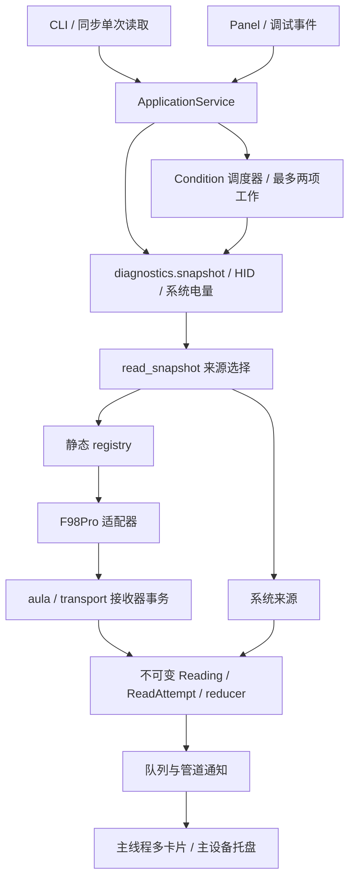

# 当前架构与扩展边界

本页描述阶段 3–6 实际落地的结构；最初的风险分析保留在 `architecture-review.md`，完整目录草图见 `refactor-plan.md`。目录未机械搬完：原生总线、HID 交换、安装入口等保留历史路径，避免无职责收益的重命名。

## 所有权

| 内容 | 唯一负责者 |
|---|---|
| Tk、卡片、IPC 接收与用户设置操作 | 主线程 `panel.py` |
| 周期截止时间、刷新合并和派发 | `application/scheduler.py`，Condition 可唤醒等待 |
| 接收器发现、连接快照代次、读数归并 | `application/service.py` |
| 支持范围、拒绝原因、适配器选择 | `domain/matching.py`、内置 profiles 与静态 registry |
| 协议帧、回复过滤与校验 | 独立协议模块；F98Pro 沿用 `aula.py` |
| fd、完整事务与跨进程互斥 | 原协议交换 + `transport.py` |
| 同步 Feature ioctl 超时边界 | 原 `debug.py` 隔离子进程 |
| SNI/D-Bus 对象、原生 context 和 loop | `tray.py` 的 GLib 线程 |
| 设置持久化与绑定校验 | `config/store.py`、`config/bindings.py` |
| 最窄权限规则与安装资格 | 内置 `AccessPolicy`，管理员显式执行安装器 |

CLI 的单次读取复用服务但不启动调度线程；显式实验操作由服务管理取消管道，协议代码仍负责跨进程事务。离线解码不进入设备执行路径。面板只渲染服务快照，不决定读数是否可信，不创建读取线程或周期刷新 timer。

## 身份与状态

`Target` 是用户绑定选择（ID、VID/PID、可选物理端口、名称）；`DeviceProfile` 是已审阅协议的适用范围；`Connection` 是当前服务会话中的连接与代次。`hidrawN` 仅用于当次打开，不能当持久身份。

服务在每次有界刷新中比较接口快照（sysfs 路径、节点、版本、描述符等）。断开可以保留过期历史；观察到新连接后先清空旧设备读数。请求结果经代次与序号检查。没有增加原生热插拔事件监听，因此两次刷新间发生且所有身份事实完全相同的瞬时拔插不能保证被识别。

新鲜系统值优先；过期缓存允许已审阅适配器尝试更新；无新值时保留历史并说明原因。短暂 busy 不直接使读数失效；长期占用超过 `max(180, 2 × 刷新间隔)` 秒会按单调时钟标为过期。采样时间未知保持未知，不冒用检查时间。

## 并发与退出

不同调度资源可并发，最多两项；同一目标的重复刷新最多合并为一次后续意图。确定物理接收器后，整个请求/回复持有按 sysfs 资源 hash 的排他锁；不同资源互不占用。无物理证据的旧调用使用全局排他门，不能绕开已有事务。

显式调试采用全局屏障，先等活动读取完成再执行；它暂缓所有后台目标，是有意保留的保守选择。协议 ioctl 仍可能受驱动限制，取消管道不能保证取消任意内核操作，Feature 保留隔离进程。

退出顺序为拒绝新任务 → 唤醒/取消 I/O → 收尾调度与工作池、停止托盘 → 关闭 IPC 和管道 → 销毁 Tk。关闭期间的 25ms 检查只用于收尾，不用于空闲刷新。

## 扩展流程

新增已知协议设备主要增加精确 profile、独立适配器、真实报文夹具与状态测试，再由静态 registry 注册；需要直接 HID 权限时，另加独立审阅的 AccessPolicy。卡片和调度不加型号分支。

绑定 JSON 只选择设备，不能定义代码或请求；离线标定 JSON 不能安装后台适配器。标准 HID 目前仅有显式 Feature 调试和候选解码，未经实机证据不加入自动来源。多卡片能力已经用两个模拟设备验证，第二种真实设备尚未认证。托盘保持一个图标，显示第一台绑定设备。

IPC version 2 保留旧 `battery`、pid、visible 等字段，并附加 `batteries/targets`。默认 `--once` 的单对象 JSON 与旧出口状态规则保留；多设备只使用显式 `--once-all` 输出。设置升级只发生在用户显式保存时，自启、桌面与权限不会因读取配置而自动修复。
