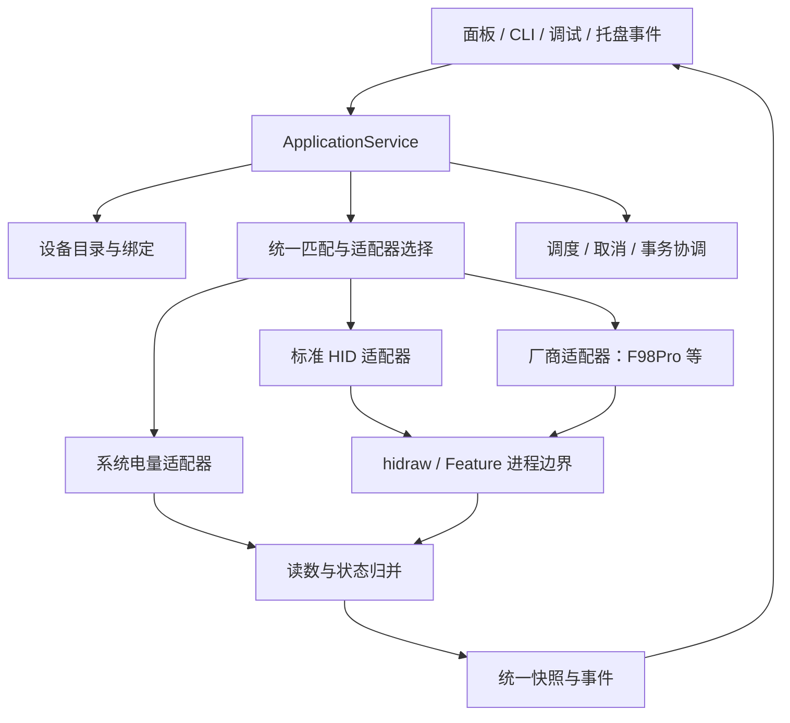

# 完整重构方案：设备适配器与统一电量服务

状态：阶段 0–5 已交付，阶段 6 的单元、隔离桌面及当前 F98Pro 验收已通过；剩余人工场景见 [重构进度](refactor-progress.md)。实际模块边界与有意保留的历史路径见 [当前架构](architecture.md)。标准 HID 仅显式 Feature 调试与候选解码，未启用通用自动读取。本页保留目标结构和实施依据，不将目录草图中的每个文件视为已创建或已认证功能。

目标是让新增设备主要修改“设备档案、协议模块、测试夹具”，不再同步修改 UI、调度、权限判断和 CLI 各处的型号分支。
完整重构按可验证阶段落地；保留已验证的 F98Pro 字节协议、现有启动脚本和已安装入口，避免让结构迁移与硬件协议重做相互干扰。

## 1. 核心选择

- 单进程、模块化核心服务；不引入独立守护进程、数据库、Web 服务或第三方 Python 框架。
- 保持标准库 + ctypes，Tk 主线程和 GLib 原生线程各有清晰所有权。
- UI、CLI、调试界面均通过同一应用服务访问设备，不各自实现读取和状态合并。
- 静态注册已审阅的适配器；不自动加载第三方 Python 文件，不让任意 JSON 获得代码执行或后台发送资格。
- 支持多个设备的内部模型；UI 按用户已绑定设备生成卡片，不把所有枚举接口都显示成设备。

## 2. 目标结构

```text
my_devices.py                  # 保留脚本路径与旧命令，薄入口
keyboard_power/
  domain/
    identity.py                # 物理设备、接口、绑定与连接代次
    readings.py                # 读数、来源、时间与有效性
    matching.py                # 匹配结果与执行资格
    state.py                   # 纯状态归并规则
  application/
    service.py                 # 发现、绑定、刷新、诊断、退出
    scheduler.py               # 截止时间、合并、取消和有界并发
    registry.py                # 已审阅适配器注册与选择
    onboarding.py              # 候选证据与接入流程，不负责猜协议
  adapters/
    system_power.py            # power_supply / UPower 来源
    standard_hid.py            # 标准电量字段的真实读取
    aula_f98pro.py              # 当前协议实现与兼容档案
  transport/
    hidraw.py                  # fd、身份复核、非阻塞交换、报告封装
    coordinator.py             # 接收器级事务锁/调试独占
    feature_worker.py          # 同步 ioctl 的受控进程边界
  platform/
    inventory.py               # 枚举和热插拔，现有 hid.py 分阶段迁入
    dbus_runtime.py            # GIO/GLib 绑定与原生线程
    instance.py                # 单实例、版本化 IPC
    installation.py            # XDG 入口、权限规则渲染与核验
  presentation/
    cli.py                     # 参数与输出，不直接访问 HID
    panel.py                   # 卡片/设备选择/设置
    tray.py                    # SNI/菜单，不决定电量是否可信
    laboratory.py              # 调试与标定，复用同一服务
  config/
    store.py                   # 用户配置、原子写入、版本处理
    profiles.py                # 已审阅档案与候选标定的不同 schema
```

目录是迁移目标，不要求首日建出全部空模块。每个模块出现时应有真实职责和消费者，不加只转发一层的空基类。



## 3. 身份匹配：集中证据，区分候选与支持

需要三个不同的标识，不能继续用 hidrawN 或 descriptor hash 兼任全部职责：

| 标识 | 含义 | 生命周期 |
|---|---|---|
| 设备档案 ID | 某种型号/连接模式/已支持版本，例如 aula-f98pro-2g | 随适配器发布 |
| 用户绑定 ID | 用户选择的一台物理设备 | 用户设置中持久保存 |
| 连接 ID 与代次 | 本次插入及当前接口集合 | 拔插/替换后改变，旧结果不得写回新连接 |

序列号可靠时用于区分同型号设备；没有序列号时可由用户明确绑定物理端口。移到其他端口后显示待确认，不伪造一个跨端口稳定 ID。
描述符 hash 证明接口形态，不能证明“是哪一台实体设备”。同接收器各接口合并，蓝牙和 USB 分别定义归组规则。

统一 matcher 返回结构化结果：支持、不匹配、候选、版本不支持、歧义，并携带匹配/拒绝原因及接口证据。
常驻读取、调试模板、诊断、权限安装都调用它；但“可以显示候选”不等于“可以自动查询”。
已支持的内置档案可按规则自动匹配；未知版本和外部导入资料只能进入候选流程。不会用匹配分数凑到阈值就发送命令。

## 4. 适配器：声明兼容范围，封装协议差异

建议契约：

```text
describe() -> 档案 ID、显示名称、版本、权限需求、能力
match(inventory) -> MatchResult
read(context, target, deadline, cancellation) -> Observation 或 ReadFailure
```

上下文提供受控 transport 与时钟，不提供 Tk、用户配置写入或任意脚本执行。
一个设备可有系统、标准 HID、厂商等多个读数来源，由应用层选择；某来源过期时，不直接阻止其他已支持来源尝试获取新值。
请求构造和回复解析继续作为可独立测试的纯函数。

transport 明确接收 `report_id` 和 `payload`，统一处理 Linux 编号/未编号缓冲区的封装；不让每个适配器自行猜测是否需要前置 00。
不同握手、回复过滤、分片与校验仍属于协议，不强行塞进一个“通用 query 循环”。
标准 HID 适配器先实现描述符已声明、可精确解析的 Feature/厂商 Input 场景；混合普通键盘输入集合不默认启用监听，更不保存按键内容。

## 5. 状态：把读数、连接和读取结果分开

当前一个 status 同时承载多种含义，且 Panel 自行保留旧值。目标改为：

```text
Reading       = 百分比/等级、来源、样本时间（可未知）、接收时间、质量
ReadAttempt   = 请求序号、开始/结束、成功/超时/权限/忙/取消、失败原因
DeviceState   = 连接状态、最新可信读数、最近读取结果、是否过期
```

由纯 reducer 产生快照，UI 和 CLI 不再各自拼字典。需要明确以下规则：

1. 本次没有新读数的失败，不覆盖最后可信值；立即标记其过期/连接状态与失败原因。
2. 收到较新的、有样本的 stale 数据，不能因为状态不是 ok 就丢弃它；按可比较的样本时间与来源策略处理。
3. 样本时间未知时保留未知，不用查询时间冒充。不同来源的时间无法比较时使用明确来源策略，不臆造时序。
4. 同一来源按连接代次和请求序号防止乱序回写；旧连接结果不污染重连后的设备。
5. 刷新截止时间用单调时钟；墙上时钟用于用户显示，不因系统校时形成忙循环。
6. 百分比领域允许有效 0；具体 F98Pro 适配器继续把尚未确认语义的 0 当未知，不能全局把 0 视为故障。

这样独立修复旧值覆盖较新 stale 样本的问题，并为多来源/多设备建立一致语义。

## 6. 调度与锁：按接收器协调，调试也不能绕开

核心服务拥有一个事件驱动的调度循环，使用截止时间队列与可唤醒等待；不再让每个卡片创建 timer 和工作线程。
发现/断开、UPower 更新、用户刷新、到期刷新与退出进入同一命令/事件队列。平台允许时使用事件监听；必要的重新枚举作为有界定时任务，不高频轮询。

- 同一设备的重复刷新合并，执行中最多保留一个后续刷新意图。
- 同一物理接收器默认串行，即使有多个 HID 接口，避免共享回复队列互相抢包。
- 独立接收器可通过小型有界工作池并发，默认上限先取 2；实际值经 CPU/退出测试再确定。
- 调试获得该接收器的独占操作期，自动轮询暂缓；“忙”是调度状态，不应直接把当前电量变成读取故障。
- 锁仍覆盖完整请求/回复事务；跨进程按已确认接收器资源生成锁键，不能只按可复用的 hidrawN 生成。
- USB 写入和 ioctl 的超时能力受驱动限制；selector 截止时间不能保证驱动内部调用可即时取消。需要的阻塞操作保留进程隔离，不把强杀当一般清理流程。

Tk 主线程只渲染和发命令；GLib 线程拥有 D-Bus 回调；核心服务和工作池不调用 Tk。使用现有管道通知思路，不改成 100ms 队列轮询。
关闭由统一 service.close 发起：拒绝新任务、取消调度、唤醒 I/O、收尾工作、注销托盘与总线、关闭 IPC/fd，再结束 UI。

## 7. 配置与自动适配：把证据和执行资格分开

保留现有 calibration v1 的离线用途；引入另一种有明确 kind/schema/version 的运行档案，不能仅修改一个布尔值就把旧标定 JSON 变成后台插件。
内置运行档案只引用静态注册的 codec ID，声明身份、兼容版本、报告形态、只读能力和验证依据。
导入的配置不允许 Python 导入路径、eval、shell 命令或任意表达式。

自动化流水线目标：

```text
采集能力 → 精确匹配既有档案 → 显示支持/拒绝原因
未匹配 → 生成候选证据 → 离线标定与夹具 → 明确授权的实测
       → 审阅后注册已支持档案 → 用户绑定 → 后续自动读取
```

能自动化的是收集、比较、模板生成、解析校验、已知适配器选择和测试执行；未知命令含义、物理设备归属与电量语义仍需要独立证据。
未来若要允许声明式简单协议，先限制命令与解析器能力、建立验证夹具和启用流程，再支持有限执行；首版重构不必同时交付它。

## 8. UI、CLI 和安装兼容

面板按已绑定设备生成卡片；型号、来源、更新时间和托盘文字来自快照，不在 UI 中写 F98Pro 常量。
默认只显示已有那台设备，内部多设备能力不会使所有 HID 突然出现在用户面板上。
调试页区分接口事实、协议候选、已支持读取和访问权限，让用户知道下一步缺的是权限还是协议证据。

保留 `my_devices.py`、现有 flags、旧 JSON 输出字段和默认单设备行为。新多设备命令与 IPC 增加显式版本/选择参数，不悄悄把原单对象 JSON 改成数组。
重复启动的新设备选择应作为服务命令被明确接受或拒绝，不能再次默默忽略。

权限规则渲染共用档案身份；普通应用只生成/展示所需规则，管理员安装仍是显式步骤。不引入 root 常驻服务。
XDG 自启和桌面入口保持当前路径与用户选择，配置迁移只有确定规则才写入，并保留回退材料；“读取配置”不能触发自启修复。

## 9. 实施阶段与完成标准

| 阶段 | 交付 | 完成标准 |
|---|---|---|
| 0 基线 | 新快照、契约/副作用清单、现有 38 项测试 | 已有修改受保护，旧入口/报文/配置已明确 |
| 1 身份与状态 | 类型模型、统一 matcher、纯 reducer | 版本拒绝与调试口径统一；stale、0、时钟与乱序测试通过 |
| 2 后端 | F98Pro 适配器、来源接口、注册表与 transport 边界 | F98Pro 原始字节夹具不变；系统与标准 HID 来源有独立证据 |
| 3 服务 | 统一调度、连接代次、接收器事务、取消关闭 | 多模拟设备互不阻塞，同接收器不抢包；退出无遗留任务 |
| 4 表现层 | 多卡片能力、通用名称、调试/CLI 接入同服务 | 默认单设备操作兼容，CLI/IPC 不破坏既有消费者 |
| 5 安装与引导 | 档案驱动的权限说明、配置版本、安装核验 | 保留用户禁用状态和现有链接，不静默迁移/扩大权限 |
| 6 验收与清理 | 隔离总线/模拟设备测试、实机验证、删除过渡代码 | F98Pro 实测、三次启停、取消、重连和 CPU；未覆盖场景如实记录 |

系统来源或标准 HID 功能没有真实硬件时，模拟通过只能标记为实验支持，不能阻塞已验证 F98Pro 的迁移，也不能宣称已完成所有设备认证。
第一批可合入成果应是阶段 1：先固定身份与状态契约，避免后面的注册表、UI、权限一起围绕错误语义重建。

## 10. 验证策略与回退

- 保留已有 38 项测试的行为断言；可以迁移 import/mock 位置，不放宽请求/回复/退出要求。
- 新增身份负例、状态序列、假时钟调度、同接收器冲突、多接收器并发、取消、连接代次与旧配置迁移测试。
- 注入 Clock、Inventory、Transport 和系统来源；不能靠“测试传入一个特殊 VID”来假装不会碰硬件。
- 原生托盘测试使用独立测试总线和可控宿主；不退出用户当前实例做普通回归测试。
- 在明确安排的实机验收中重复 75 秒 CPU 测量，并统计所有应用工作进程；旧 0.020s 不作为新架构的成绩。
- 保留旧脚本作为薄兼容入口；迁移中只在一处选择旧/新实现，不长期维护两套各自写设置的后台。
- 每阶段输出补丁与测试结果。未通过时仅回退本阶段改动，不覆盖用户并行修改或重新生成用户安装配置。

这次完整重构的成功指标：新增已知协议设备后，改动集中在档案、codec、真实样本和测试；UI/调度/安装无需再添加该型号的条件分支。
